# Mermaid

A ` ```mermaid ` block is drawn on GitHub, GitLab, Azure DevOps, Obsidian, Notion and most documentation sites. The first word says which diagram.

## Flowchart

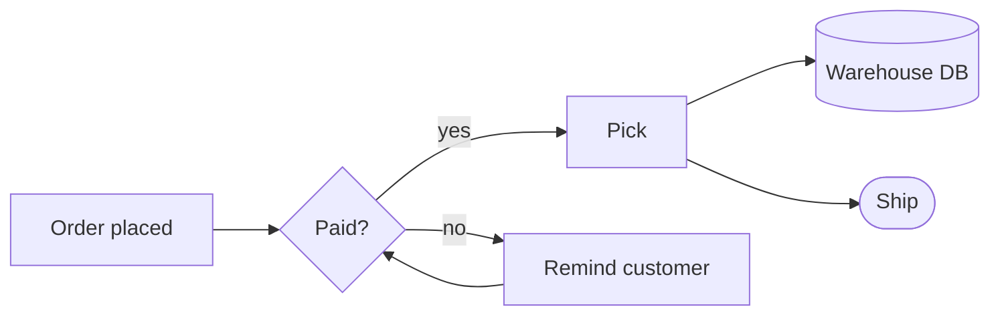

## Sequence

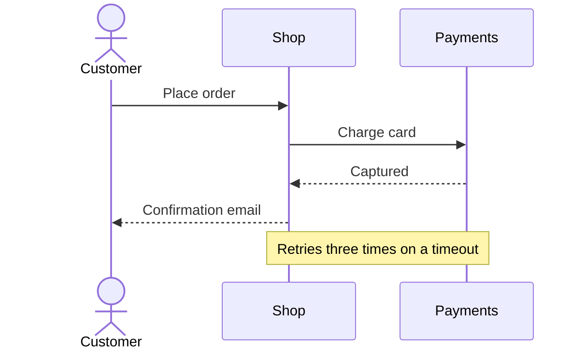

## Class

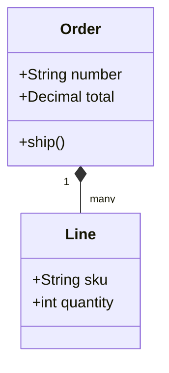

## State

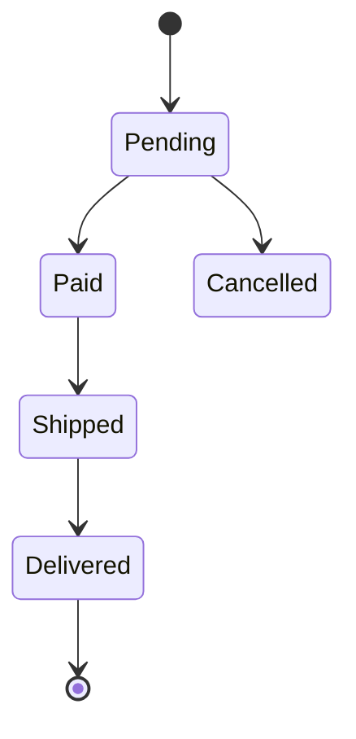

## Entity relationship

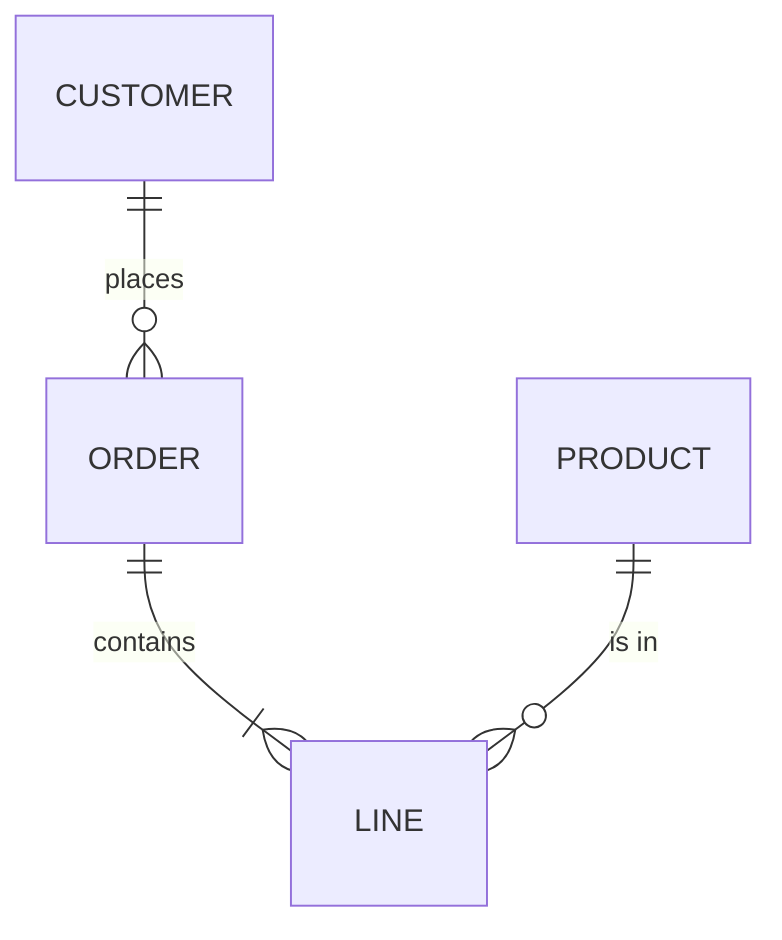

## Gantt

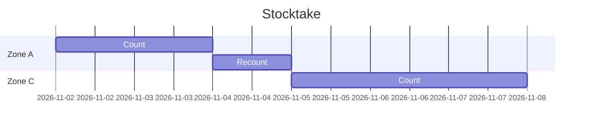

## Pie

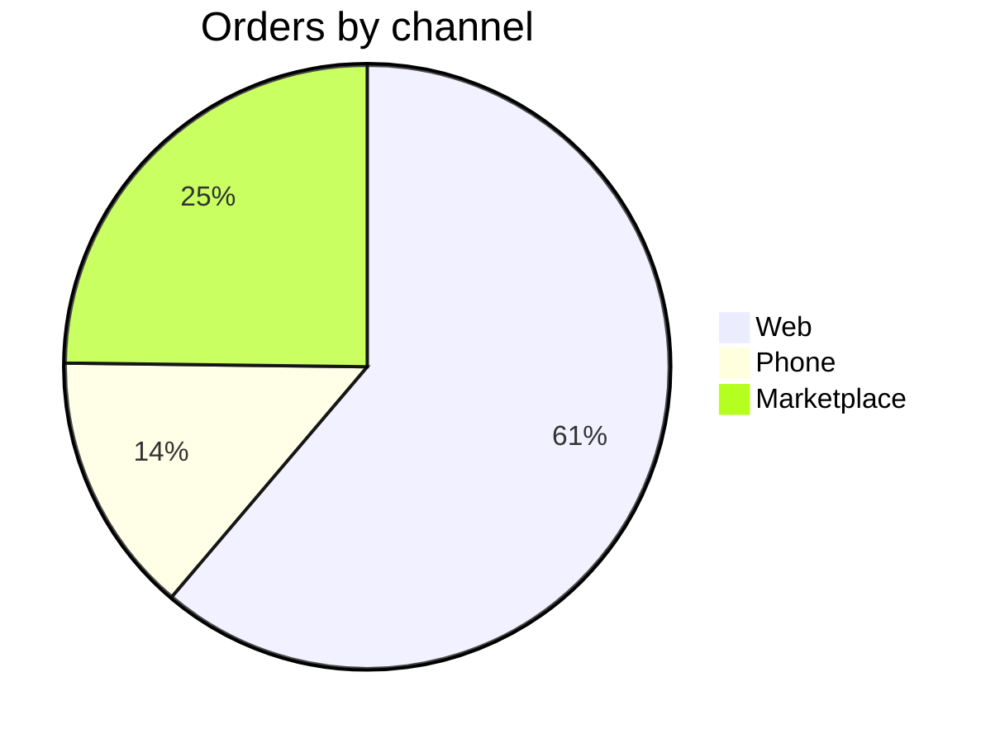

## Git graph

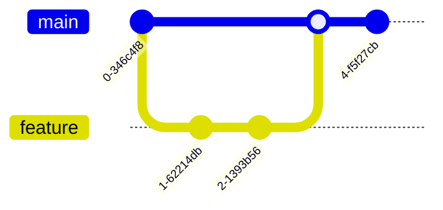

## Mind map

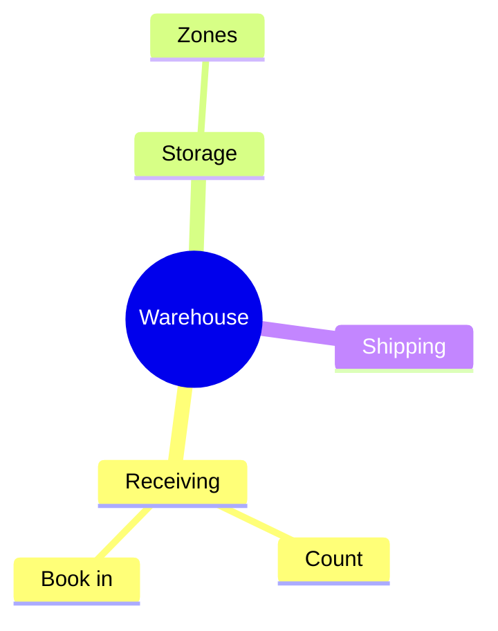

## Timeline

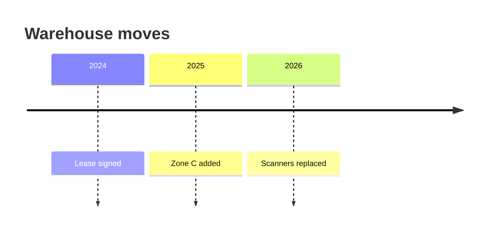

## Chart

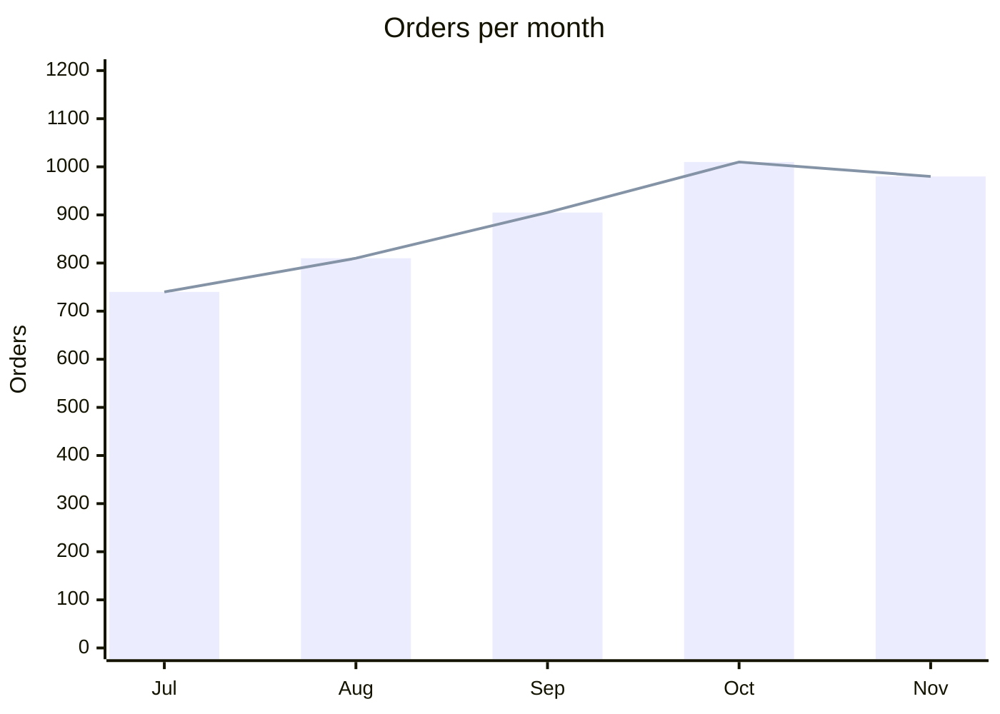

## Quadrant

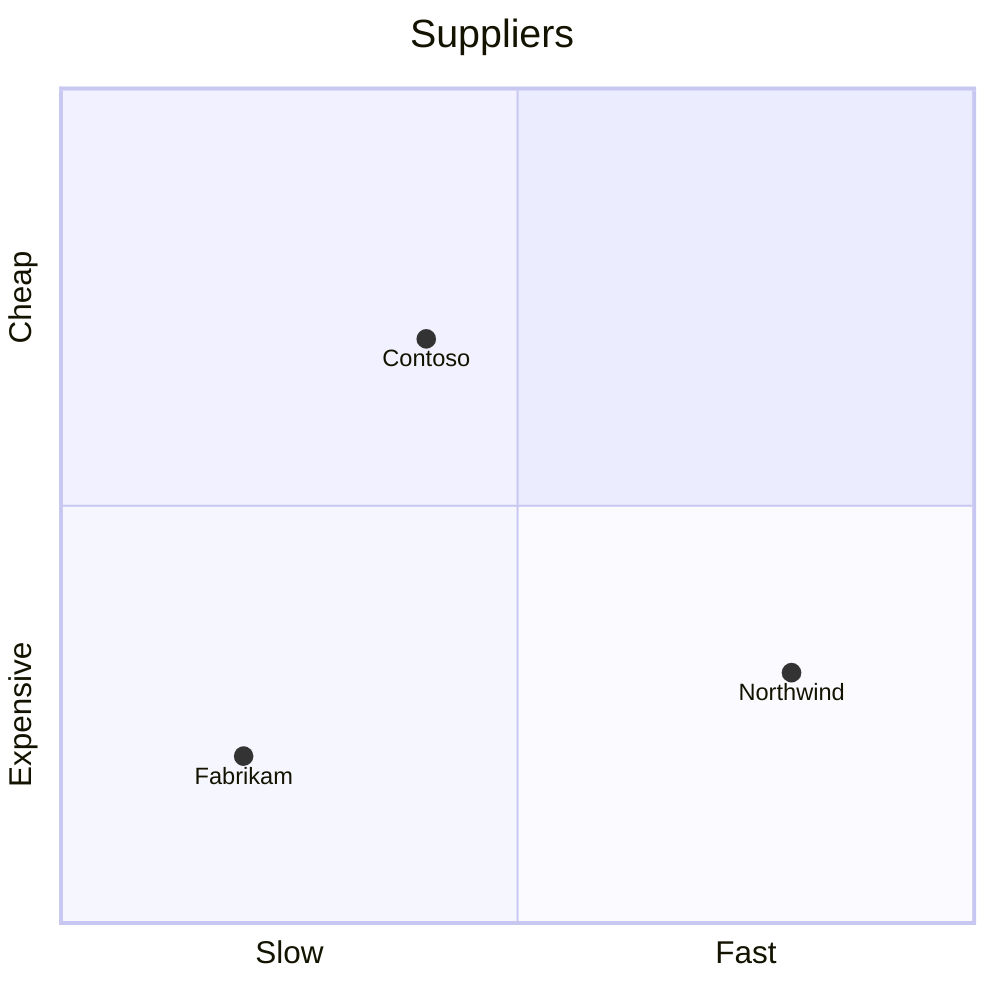

## User journey

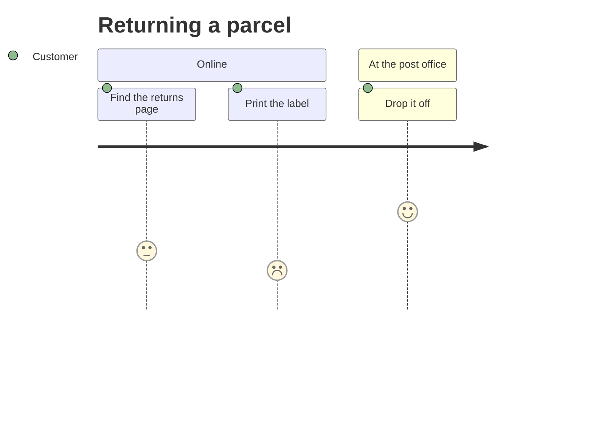
