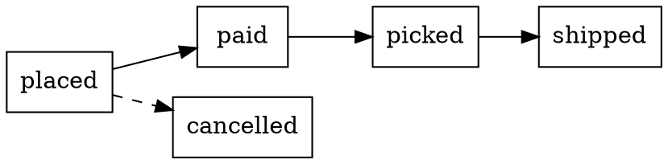
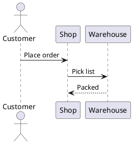

# Other diagrams

Fenced blocks other tools draw. GitHub draws maps and 3D models itself; the rest need GitLab, Kroki, a documentation site's plugin or an editor extension.

## Map: GeoJSON (GitHub)

```geojson
{
  "type": "FeatureCollection",
  "features": [
    {
      "type": "Feature",
      "properties": { "name": "Warehouse" },
      "geometry": { "type": "Point", "coordinates": [17.107, 48.148] }
    },
    {
      "type": "Feature",
      "properties": { "name": "Delivery area" },
      "geometry": {
        "type": "Polygon",
        "coordinates": [[[17.0, 48.1], [17.25, 48.1], [17.25, 48.22], [17.0, 48.22], [17.0, 48.1]]]
      }
    }
  ]
}
```

## Map: TopoJSON (GitHub)

```topojson
{
  "type": "Topology",
  "objects": {
    "zones": {
      "type": "GeometryCollection",
      "geometries": [{ "type": "Polygon", "arcs": [[0]], "properties": { "name": "Zone A" } }]
    }
  },
  "arcs": [[[17.0, 48.1], [17.1, 48.1], [17.1, 48.2], [17.0, 48.2], [17.0, 48.1]]]
}
```

## 3D model: STL (GitHub)

```stl
solid carton
  facet normal 0 0 -1
    outer loop
      vertex 0 0 0
      vertex 1 1 0
      vertex 1 0 0
    endloop
  endfacet
  facet normal 0 0 -1
    outer loop
      vertex 0 0 0
      vertex 0 1 0
      vertex 1 1 0
    endloop
  endfacet
  facet normal 0 -1 0
    outer loop
      vertex 0 0 0
      vertex 1 0 0
      vertex 0.5 0.5 1
    endloop
  endfacet
  facet normal 1 0 0
    outer loop
      vertex 1 0 0
      vertex 1 1 0
      vertex 0.5 0.5 1
    endloop
  endfacet
  facet normal 0 1 0
    outer loop
      vertex 1 1 0
      vertex 0 1 0
      vertex 0.5 0.5 1
    endloop
  endfacet
  facet normal -1 0 0
    outer loop
      vertex 0 1 0
      vertex 0 0 0
      vertex 0.5 0.5 1
    endloop
  endfacet
endsolid carton
```

## Graphviz



## PlantUML



## D2

```d2
shop -> payments: charge
payments -> shop: captured
shop -> warehouse: pick list
warehouse: {shape: cylinder}
```

## Vega-Lite

```vega-lite
{
  "$schema": "https://vega.github.io/schema/vega-lite/v5.json",
  "data": {
    "values": [
      { "month": "Jul", "orders": 740 },
      { "month": "Aug", "orders": 810 },
      { "month": "Sep", "orders": 905 },
      { "month": "Oct", "orders": 1010 }
    ]
  },
  "mark": "bar",
  "encoding": {
    "x": { "field": "month", "type": "ordinal", "sort": null },
    "y": { "field": "orders", "type": "quantitative" }
  }
}
```

## Music: ABC notation

```abc
X:1
T:Loading bay waltz
M:3/4
L:1/8
K:G
|: G2 B2 d2 | c2 A2 F2 | G2 B2 d2 | e4 d2 :|
```

## Timing: WaveDrom

```wavedrom
{ "signal": [
  { "name": "clock", "wave": "p......" },
  { "name": "scan",  "wave": "0.1..0." },
  { "name": "label", "wave": "x.=..x.", "data": ["A-17"] }
]}
```

## ASCII art: Svgbob

```svgbob
  +--------+      +---------+
  | Dock 1 |----->| Zone A  |
  +--------+      +---------+
                       |
                       v
                  +---------+
                  | Packing |
                  +---------+
```

## Nomnoml

```nomnoml
[Order|number;total|ship()] -> [Shipment]
[Order] +-> 1..* [Line]
```

## Mind map from headings: Markmap

```markmap
# Warehouse
## Receiving
### Count
### Book in
## Shipping
```

## Chart from YAML: Obsidian Charts

```chart
type: line
labels: [Jul, Aug, Sep, Oct]
series:
  - title: Orders
    data: [740, 810, 905, 1010]
```

## flowchart.js

```flow
st=>start: Order placed
op=>operation: Pick
cond=>condition: In stock?
e=>end: Ship
st->cond
cond(yes)->op->e
cond(no)->st
```
